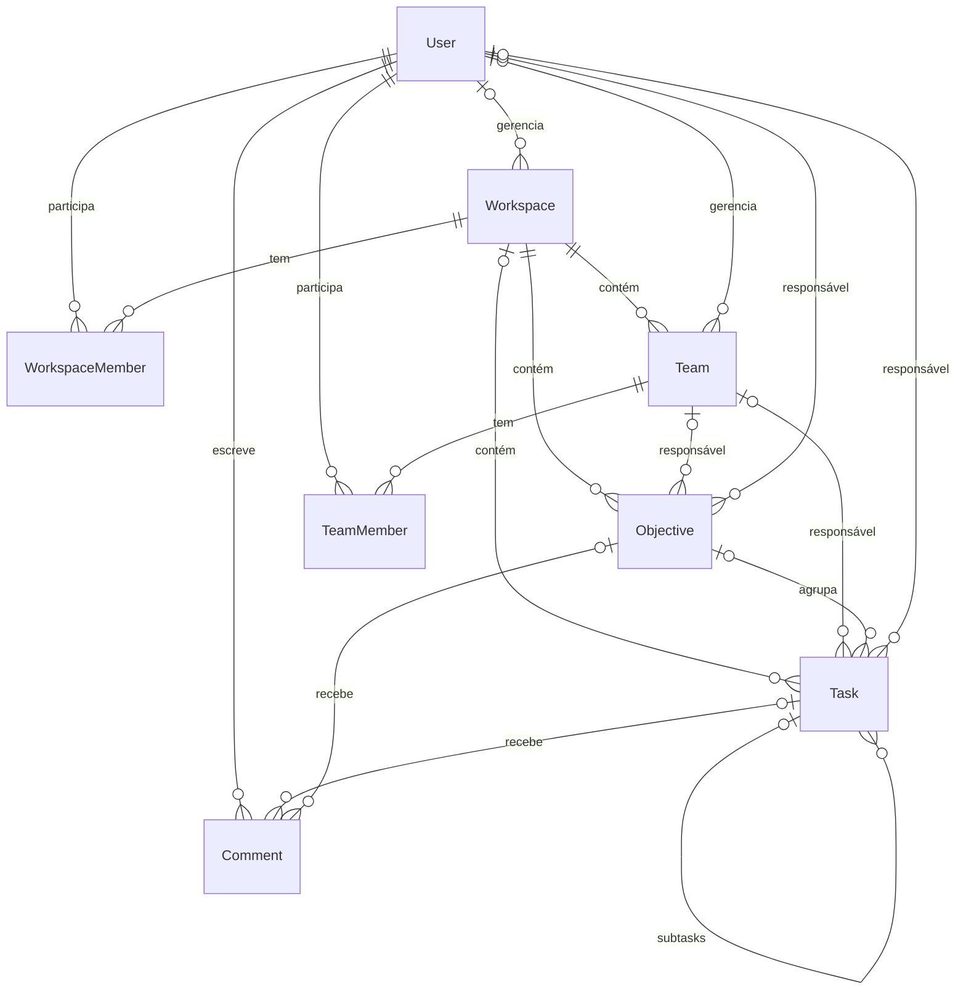

# Visão geral do domínio

O Task Manager organiza trabalho dentro de **Workspaces**. Este documento é o mapa: define os termos, mostra como as entidades se relacionam e reúne as dúvidas que valem para mais de uma entidade.

> **Analogia:** o Workspace é uma empresa. A Team é um departamento. O Objective é uma meta do trimestre e a Task é uma tarefa dessa meta. Os "Member" são os crachás que ligam uma pessoa à empresa (Workspace Member) ou ao departamento (Team Member).

## Termos

Os nomes em inglês são os mesmos usados no banco de dados e no código.

| Termo | O que é |
|-------|---------|
| User | Pessoa com conta no sistema. |
| Workspace | Espaço onde um projeto é organizado. Tem um gerente e membros. |
| Workspace Member | Vínculo entre um User e um Workspace ("este User participa deste Workspace"). |
| Team | Grupo de pessoas dentro de um Workspace. |
| Team Member | Vínculo entre um User e uma Team. |
| Objective | Meta dentro de um Workspace. Agrupa Tasks. |
| Task | Unidade de trabalho. Pertence a um Workspace ou a um Objective e pode ter subtasks. |
| Comment | Comentário de um User em uma Task ou em um Objective. |

## Diagrama de relacionamentos

Mostra o que o banco permite **hoje**. "Zero ou um" indica relação opcional.

## Como ler os documentos das entidades

Cada arquivo segue a mesma ordem: **o que é**, **campos**, **relacionamentos**, **regras** e **pendências**.

| Marca | Significado |
|-------|-------------|
| Atual | O que o código e o banco fazem hoje. |
| Desejado | O que o requisito manda. Será preenchido na etapa de requisitos. |
| Pendente | Decisão em aberto. Cada uma tem um código (ex.: `WSP-P1`) para ser citada. |

Neste momento as regras estão marcadas como **Atual** e as dúvidas como **Pendente**. A coluna **Desejado** só entra depois que as pendências forem decididas.

Fonte: `prisma/schema.prisma` e os controllers em `src/controller/`.

## Pendências gerais

| Código | Dúvida | Por que importa |
|--------|--------|-----------------|
| GEN-P1 | Qual é a fonte da verdade da conclusão? O Workspace só tem `completedAt`. Task e Objective têm `status` e `completedAt`, e hoje "concluir" só preenche `completedAt`, sem mudar o `status`. | Os dois campos podem se contradizer. |
| GEN-P2 | Os textos de User, Workspace e Task são salvos em minúsculas; Team e Objective não. Isso é regra de negócio ou escolha de apresentação? | Define se o servidor altera o que o usuário digitou. |
| GEN-P3 | Toda exclusão apaga de vez e em cascata. Deve existir arquivamento ou "lixeira"? | Excluir um Workspace apaga tudo dentro dele, sem volta. |
| GEN-P4 | Nenhuma entidade guarda data de atualização nem histórico de mudanças. Isso será necessário? | Auditoria e sincronização com o app Android. |
| GEN-P5 | A palavra "manager" tem três sentidos: gerente do Workspace, gerente da Team e responsável por Task ou Objective. Padronizar o termo? | Evita ambiguidade na documentação e nos contratos. |
| GEN-P6 | Os nomes de campos misturam estilos (`project_name` contra `createdAt`). Qual padrão adotar? | Os nomes viram o contrato com o cliente Kotlin. |
